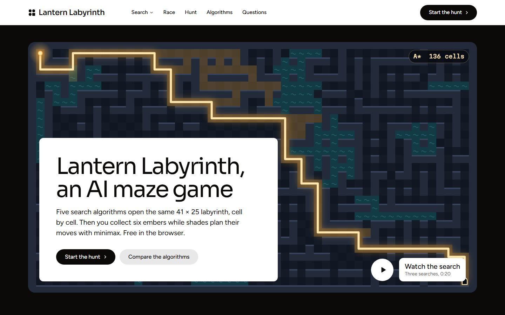

# Lantern Labyrinth

A maze game about AI search, made for a college AI course. Five search algorithms light up the same labyrinth
cell by cell, then you collect six embers while shades plan their moves with minimax.



## The problem

A lantern-bearer is lost in a labyrinth. Stone costs 1 to cross and water costs 5.

1. **Find the way to the door.** Which route, and how much of the labyrinth do you have to open to find it?
2. **Survive the shades.** Collect six embers while one or two shades hunt you. How does a shade choose a move
   against a player who fights back?

## Where the AI is

| Part of the game | Algorithms | What you see |
|---|---|---|
| Search lab | BFS, DFS, uniform-cost search, greedy best-first, A* (Manhattan heuristic, adjustable weight w) | Every opened cell glows in order, the frontier flickers, the next cell to open is ringed, and the frontier's queue is listed with g, h and f. Hover any cell to read its g, h and f. |
| Race | All five on one map | Five boards side by side and a scoreboard: cells opened, path cost, and which ones found the cheapest path. |
| Shadow hunt | Depth-limited **minimax** with **alpha-beta pruning** and move ordering, **expectimax**, and a plain BFS **chase** as the baseline | The top two levels of the shade's game tree, how many positions alpha-beta skipped compared with plain minimax, and dotted trails of the line the shade expects you to play. |

The shades score a position with an evaluation function, from the lantern's side:

```
score = 100 × embers collected − 3 × steps to the nearest ember − Σ 60 ÷ (steps to each shade + 1)
        (+15 when two shades stand on one cell, so they learn to split up)
```

Maze distances are precomputed with a BFS from every cell. On the default map (map 28), A* opens 154 cells and
UCS opens 566, and both find the cheapest path, cost 72. Greedy opens 85 but pays 120, and BFS pays 144 because it
wades through water.

## Run it

You need [Node.js](https://nodejs.org) 22 or newer.

```bash
npm install
npm run dev        # http://localhost:5173
npm test           # the algorithm checks
npm run build      # the site, in dist/
npm run preview    # serves dist/, works offline
```

For a presentation without internet: run `npm install` and `npm run build` once while online, then
`npm run preview` works offline. Fonts fall back to system fonts without a connection.

**Live page:** turn on GitHub Pages once (Settings > Pages > Source: GitHub Actions). After that, every push to
`main` is tested, built and published by `.github/workflows/deploy.yml`.

## How the code is organised

```
src/ai/          the AI, plain JavaScript with no browser code, so it runs in Node and in the tests
  grid.js          seeded labyrinths (recursive backtracker, rooms, water)
  search.js        BFS, DFS, UCS, greedy, A* and weighted A*, plus the frontier at any step
  adversarial.js   the hunt: minimax, alpha-beta with move ordering, expectimax, chase, evaluation
src/game/draw.js the canvas drawing for the labyrinth, the hunt and the game tree
src/components/  the React parts: the hero reel, the search lab, the race, the shadow hunt, the captures
test/            node:test checks (npm test)
public/assets/   the design system's CSS and scripts (tasteskill 2.5.1 kit, loaded as plain files)
scripts/         make-posters.mjs renders key-art.webp and rays-still.webp from the game's own code
```

`npm test` checks, on 40 seeded random labyrinths: every path is valid and its cost is right, A* costs exactly as
much as UCS, no algorithm beats UCS, BFS takes the fewest steps, alpha-beta always returns the same value as plain
minimax (with and without move ordering) and never searches more positions, and expectimax never scores a shade's
position above minimax.

## Built with

- **React 19 and Vite** for the page and its game parts.
- **GSAP** for every animation in the game: the hero reel's timeline, the pieces gliding between cells, the game
  tree growing after each move, the race places and the end-of-hunt card. It also drives Lenis.
- **Lenis** for smooth scrolling (off under reduced motion).
- **React Bits** components: LightRays (the light section), ClickSpark (sparks when you click a board) and CountUp
  (the alpha-beta counts). React Bits is © David Haz, MIT + Commons Clause; see `src/components/reactbits/LICENSE.md`.
- **tasteskill 2.5.1** design system: layout, type, buttons, motion and the iris moment on the hunt section. Its
  checks (layout at five widths, consistency, copy lint, performance) pass on the built page.

## Suggested team roles

- Search algorithms, the lab and the race
- Minimax, alpha-beta, expectimax and the evaluation function
- Rendering and the page (canvas drawing, React, animation)
- Testing and the presentation
